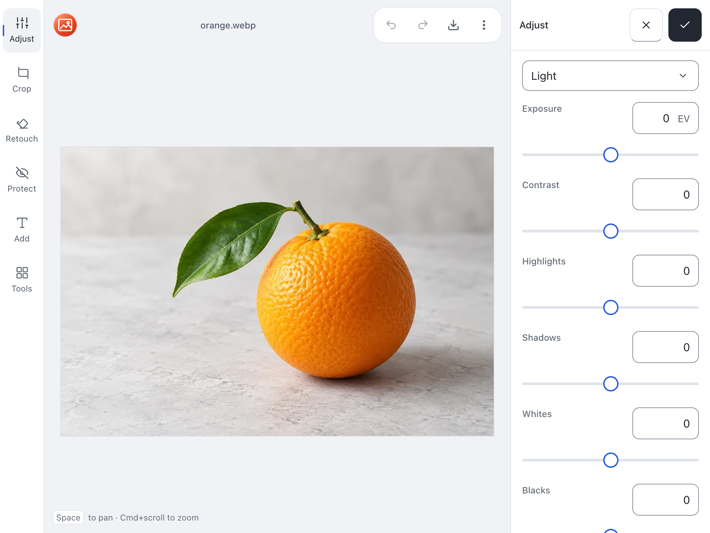
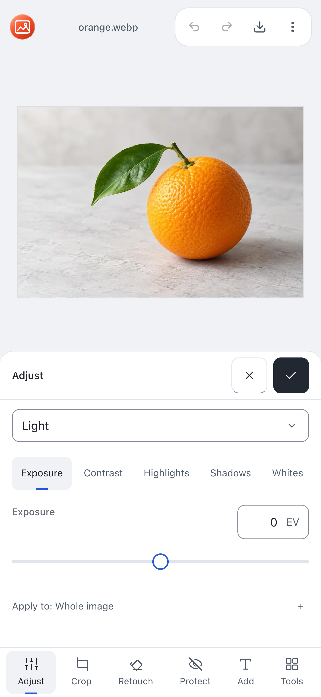

# CloakIMG

**Your photos. Your way.**

[Website](https://img.cloakyard.com/) · [Source](https://github.com/cloakyard/cloakimg) · [Support](https://ko-fi.com/sumitsahoo21)

<p align="center">
    <a href="https://opensource.org/licenses/MIT"></a>
    
    
    
  </p>

<p align="center">
  <picture>
    <source media="(prefers-color-scheme: dark)" srcset="docs/screenshots/iPad-dark.png">
    
  </picture>
</p>

## Overview

A private browser photo editor with local retouching, annotation, metadata removal and optional on-device AI. Keep the photo visible while working, then export the result in the format you need.

## Features

Everything runs 100% client-side. Tools marked ✨ use on-device AI.

- **Edit** — Crop & Rotate, Perspective, Adjust ✨, Levels ✨, Selective Colour ✨, Filters ✨ (40+ presets incl. Seasons), Time of Day, Relight ✨ (depth-aware lighting), Resize (Lanczos-3).
- **Retouch & privacy** — Spot Heal, Portrait Blur ✨, Remove BG ✨ with transparent / solid / one-colour gradient / vignette output, Redact ✨ (blur / pixelate / solid + one-tap Smart Anonymize of people or faces), Tap-to-Fix (context-aware quick action).
- **Annotate** — Text, Shapes, Draw, Pen, Emoji, Watermark, Place Image, Colour Picker.
- **Finish** — Frame (Polaroid, Film, Cinema, Vignette + more), Border (solid or aspect-padded matte), and ID Photo sheets with 26 passport / ID / visa / custom standards, six paper sizes, exact 300-DPI PDF or print output, and cut guides enabled by default.

### On-device AI

Models run locally — in a Web Worker, or on the main thread for face detection — so pixels never leave the tab. Nothing downloads until you accept an explicit consent dialog, and each model is cached after first use so AI keeps working offline.

| Model                                     | Powers                                                                                    | Size             |
| ----------------------------------------- | ----------------------------------------------------------------------------------------- | ---------------- |
| **ISNet (DIS)** via Transformers.js       | Subject scoping (Whole / Subject / Background), Portrait Blur, Remove BG, Smart Anonymize | 42 / 84 / 168 MB |
| **MediaPipe BlazeFace**                   | Smart Anonymize → per-face redaction                                                      | ~1 MB            |
| **Depth Anything V2** via Transformers.js | Relight (depth-aware directional light)                                                   | 28 / 49 MB       |

The subject mask is detected once per image and reused across every subject-aware tool.

### Workspace and export

Layered non-destructive overlays · undo/redo (`⌘Z` / `⌘⇧Z`) · hold-to-compare · reset to original · pan + pinch-zoom · single-key shortcuts · light/dark mode · focused phone controls with persistent tool shortcuts and a searchable picker · compact tablet rail and inspector.

Use **Apply** to keep a tool edit or **Cancel** to restore its starting state. On phones and tablets, **✓ applies** and **× cancels** from the fixed tool-panel header. Controls scroll below while the photo keeps at least 40% of the available editor height. Inspection and output panels use **Close**. Undo, redo and export stay beside the canvas; additional actions live in More actions on compact layouts.

Drag/drop/paste import · HEIC decode · EXIF reader + one-tap GPS/metadata strip · recents + autosave (IndexedDB) · batch mode · export to JPEG/PNG/WebP/AVIF/HEIC · exact-size ID-photo PDF/print sheets · wide-gamut (Display-P3) output.

## Privacy

- **No uploads, no servers, no telemetry** — photos and edits stay on your device; editing and export run locally; there is no image-upload endpoint.
- **On-device AI** — models download once (with explicit consent), cache locally, and run fully offline thereafter.
- **One-tap EXIF strip** — scrub GPS, camera info, and timestamps from exports.

## Getting started

Open [img.cloakyard.com](https://img.cloakyard.com/) in a modern browser. Drop, paste or browse for a photo. Choose a tool; Apply keeps its staged edit and Cancel restores the starting state. Export when ready.

The installable PWA caches its core shell after loading. Optional AI models require their own initial download; cached availability depends on browser storage.

## Development

[](https://picorunner.com/launch/?repository=https%3A%2F%2Fgithub.com%2Fcloakyard%2Fcloakimg)

Requires **Node.js ≥ 24** and **Vite+** (`npm i -g vite-plus`).

```bash
git clone https://github.com/cloakyard/cloakimg.git
cd cloakimg
vp install   # install dependencies
vp dev       # dev server with hot reload
```

| Command              | Description                                                    |
| -------------------- | -------------------------------------------------------------- |
| `vp dev`             | Dev server with hot reload                                     |
| `vp run build`       | Type-check + production build                                  |
| `vp preview`         | Preview the production build                                   |
| `vp check`           | Format, lint, and type-check                                   |
| `vp test run`        | Run the unit and component suite                               |
| `vp run test:tools`  | Open every editor tool and audit names, bounds, and touch size |
| `vp run test:visual` | Audit desktop, tablet, phone, and narrow Android layouts       |
| `vp run test:audit`  | Audit shared dialogs and responsive component contracts        |

### Verification

Run `vp check`, `vp test run`, `npx --yes knip@6.44.2` and `vp run build`. Use the applicable tool, transaction, output and browser suites under `scripts/`; models must remain behind explicit consent. Browser tooling is development-only.

### Technology

|              |                                                                                 |
| ------------ | ------------------------------------------------------------------------------- |
| Framework    | React 19 + TypeScript 7                                                         |
| Styling      | Tailwind CSS 4                                                                  |
| Canvas       | Fabric.js 7 + a 2D-canvas pipeline for filters & per-pixel ops                  |
| On-device AI | Transformers.js (ISNet, Depth Anything V2) + MediaPipe Tasks Vision (BlazeFace) |
| HEIC / HEIF  | libheif + libde265 + Kvazaar (local WASM, lazy-loaded)                          |
| Build / PWA  | Vite+ (`vp`) + vite-plugin-pwa (Workbox)                                        |
| Hosting      | Cloudflare Workers — deployed on every push to `main`                           |

## Design and assets

[DESIGN.md](DESIGN.md) is the portable Air contract; [surface coverage](docs/air/surfaces.json) records actual verification. Shared controls remain neutral in both themes. The finite sun-and-mountains artwork has its own product colour; authored image pixels are not UI colours.

### Editor previews

The README and PWA previews are real captures using the bundled local orange photograph. Run a production preview, then `BASE_URL=http://127.0.0.1:4173 vp run generate-screenshots` to capture phone and tablet layouts in light and dark. `node scripts/build-og-image.mjs` renders the separate vector social card.

<picture>
  <source media="(prefers-color-scheme: dark)" srcset="docs/screenshots/iPhone-dark.png">
  
</picture>

Dark variants live in documentation, so they do not add to the PWA's installation cache.

## Project structure

```text
cloakimg/
├── src/editor/             # Canvas, tools, history, exports and on-device AI
├── src/components/         # Shared controls and overlays
├── src/landing/            # Public pages and finite landscape artwork
├── src/styles/             # Pinned Air foundations and page shells
├── public/                 # Local assets, codecs, models and PWA previews
├── scripts/                # Asset generation and browser/design checks
├── docs/                   # Architecture and verification records
└── wrangler.jsonc          # Cloudflare static Worker configuration
```

## Deployment and releases

The production build is served as static assets by Cloudflare Workers using `wrangler.jsonc`. Run `vp run build` before `vp preview` or a deployment dry run. Work on `dev`, open a PR into `main`, merge only after required checks pass, and update `dev` from `main`.

Only the configured main-branch deployment publishes production. Check the exact main commit, hosting result and live assets; a local build does not prove deployment.

## Contributing

Read [AGENTS.md](AGENTS.md), [CLAUDE.md](CLAUDE.md) and [DESIGN.md](DESIGN.md) before changes. See [CONTRIBUTING.md](CONTRIBUTING.md) for contribution and disclosure guidance. Keep changes bounded, preserve features and output, remove obsolete references, and record actual verification. Compare all applicable views in phone, tablet, laptop and desktop layouts, both themes.

The [family README standard](https://github.com/cloakyard/cloakyard/blob/main/docs/README_STANDARD.md) defines this document's section order. Support the project through [Buy me a coffee](https://ko-fi.com/sumitsahoo21).

## License

Released under the [MIT License](LICENSE). Third-party components retain their own licenses.

Built by [Sumit Sahoo](https://github.com/sumitsahoo), part of [Cloakyard](https://cloakyard.com/).
