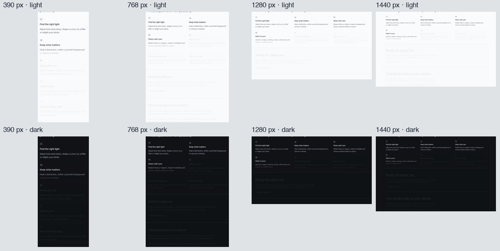

# CloakIMG landing motion and web dependencies

24 November 2026 · Air 1.8.1

Six capability entries, the ID photo introduction and the privacy explanation.

The production landing passed 22 viewport sizes in both themes in Chromium and
WebKit. The browser measured the combined 520 ms wipe, fade and 4 px settle,
checked the stagger where blocks enter together, and scrolled back through the
page to check that blocks play once. Focus, initial fragments, return from
privacy, live reduced motion, print, forced colours and the missing-observer
fallback passed. A touch profile also checked direct navigation with reduced motion.

## Dependencies and feature coverage

Compared all 24 direct web runtime and development package declarations with
the npm registry and refreshed the lockfile. Vite+ 1.8.0, jest-dom 8.0.0, user-event 14.6.13, Puppeteer Core 25.18.1 and the Node canvas alias 1.2.0. Rebuilt the local HEIC/WebP module with Emscripten 7.0.1 and the current libheif, libde265, Kvazaar and libwebp releases.

Frozen pnpm installation, build, type/lint/format checks, Knip, package audit and 501 unit tests. Entry checks covered 204 responsive, theme and text observations plus PNG pixel fidelity. A real HEIC opened in the editor. Compared its decoded RGBA and nine HEIC encode/decode cases with the previous binary. WebP output matched at three quality levels. Export, undo/redo and reset passed.

This review covered the web landing and the listed regression checks on local
builds. Physical-device and assistive-technology acceptance remain open.
